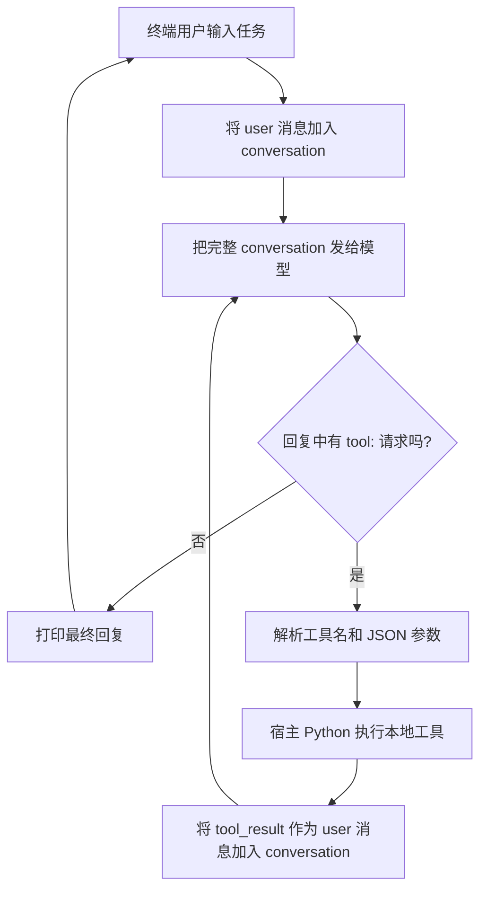

# 从零构建 Coding Agent：代码阅读笔记

对应源码：[`code/coding_agent_from_scratch.py`](code/coding_agent_from_scratch.py)

## 1. 这段程序做了什么

这是一份约 200 行的最小 coding agent 实现。它把普通的大语言模型包装进一个循环，使模型不仅能回答问题，还能通过宿主 Python 程序完成三类本地操作：

- `read_file`：读取文件全文；
- `list_files`：列出某个目录中的直接子项；
- `edit_file`：创建、覆盖文件，或者替换文件中的第一个指定片段。

核心思想不是让模型直接获得文件系统权限，而是让双方遵守一个文本协议：模型输出工具请求，Python 解析、执行请求，再把结果送回模型。模型根据结果继续思考，直到输出不含工具请求的普通回答。

因此，它与普通聊天程序的关键区别是：**聊天模型被放进了“观察—行动—再观察”的循环中**。

## 2. 运行前提

源码依赖以下第三方包：

```bash
python3 -m pip install openai python-dotenv
```

在项目当前目录或其父目录准备 `.env`：

```dotenv
OPENAI_API_KEY=your_api_key_here
```

然后运行：

```bash
python3 "01 - The Internals of Coding Agents/code/coding_agent_from_scratch.py"
```

需要注意：

- 源码通过 `os.environ["OPENAI_API_KEY"]` 读取密钥，变量不存在时会立即报错；
- 源码中的嵌套 f-string 使用了 Python 3.12 才正式支持的语法，建议使用 Python 3.12 或更新版本；
- 模型名称写死为 `gpt-5.6-terra`，实际运行时需要账户有权访问该模型，否则应自行换成可用模型；
- 当前仓库没有依赖清单，默认 Python 环境也未安装 `python-dotenv`，需要手动安装依赖。

## 3. 整体工作流



其中有两个不同层次的循环：

1. 外层循环负责不断接收新的终端输入，相当于维持整个聊天会话；
2. 内层循环负责完成当前任务，一次任务可以连续读取目录、读取文件和编辑文件，然后才返回最终答案。

`conversation` 是 agent 的短期记忆。每次请求都会把整个列表发送给模型，所以模型能够看到之前的用户要求、自己的工具请求以及工具执行结果。

## 4. 代码模块拆解

### 4.1 初始化模型客户端

`load_dotenv()` 把 `.env` 中的变量加载到进程环境，随后使用 `OPENAI_API_KEY` 创建 `OpenAI` 客户端。客户端在模块导入时就会创建，而不是等主循环开始后再创建。

### 4.2 系统提示词与工具协议

`SYSTEM_PROMPT` 同时完成两件事：

- 告诉模型它是一个 coding assistant；
- 规定工具请求必须写成单独一行：

```text
tool: TOOL_NAME({"argument": "value"})
```

这不是 OpenAI API 的原生 function calling，而是课程示例自行设计的纯文本协议。它结构直观，方便理解 agent 的底层循环，但可靠性低于带 schema 校验的原生工具调用。

### 4.3 三个本地工具

`resolve_abs_path()` 统一处理路径：展开 `~`，并将相对路径解释为相对于当前工作目录的绝对路径。

`read_file_tool()` 读取完整文件并返回实际路径与文本内容。它没有限制文件大小，也没有限制文件必须位于当前项目内。

`list_files_tool()` 只列出目标目录的第一层内容，不会递归遍历；每项被标记为 `file` 或 `dir`。

`edit_file_tool()` 有两种模式：

- `old_str == ""`：用 `new_str` 创建或覆盖整个文件；
- `old_str != ""`：寻找第一次出现的旧文本并替换；找不到时不修改文件。

只替换第一次出现的位置可以降低批量误改的概率，但并不能防止模型修改错误文件。

### 4.4 工具注册与自动描述

`TOOL_REGISTRY` 将模型使用的工具名映射到真正的 Python 函数。它承担两个职责：

1. `create_full_system_prompt()` 遍历注册表，将每个函数的 docstring 和 `inspect.signature()` 生成的签名写进提示词；
2. 主循环根据模型返回的工具名，从注册表取出函数并执行。

这样添加一个新工具时，主要工作是实现函数并注册它，工具说明会自动进入提示词。不过，当前主循环仍然使用 `if/elif` 手动提取参数，尚未做到完全通用的动态分派。

### 4.5 解析模型回复

`extract_tool_invocations()` 逐行检查模型文本，只处理以 `tool:` 开头的行。对于：

```text
tool: read_file({"filename":"app.py"})
```

它会提取：

```python
("read_file", {"filename": "app.py"})
```

`json.JSONDecoder().raw_decode(rest)` 会从左括号后的内容开头读取一个 JSON 值，并返回停止位置；代码没有使用该停止位置，因此结尾的 `)` 以及其他尾随文本实际上不会被严格验证。解析失败的行会被静默忽略。

### 4.6 调用模型

`execute_llm_call()` 使用 Responses API，把完整 `conversation` 传给模型，并返回 `response.output_text`。最大输出长度设置为 5000 tokens。

这层函数没有重试、超时或 API 异常处理，网络错误、限流和无权访问模型等问题都会直接终止程序。

### 4.7 Agent 主循环

主循环首先插入一条 `developer` 消息，其中包含完整的系统提示词和工具说明。

每当用户输入任务后，内层循环执行以下步骤：

1. 调用模型；
2. 保存并打印模型回复；
3. 若没有工具请求，将回复视为本轮最终答案；
4. 若存在工具请求，执行对应函数；
5. 将结果序列化为 `tool_result(...)`，作为新的 `user` 消息追加到上下文；
6. 再次调用模型。

收到 EOF 或按下 `Ctrl+C` 时，外层循环结束，程序退出。

## 5. 一次编辑任务如何完成

假设用户输入：

```text
请把 app.py 中的 DEBUG = True 改为 DEBUG = False
```

一次可能的消息流如下：

```text
用户 -> 模型：请修改 app.py

模型 -> 宿主：
tool: read_file({"filename":"app.py"})

宿主 -> 模型：
tool_result({"file_path":"/.../app.py","content":"DEBUG = True\n"})

模型 -> 宿主：
tool: edit_file({"path":"app.py","old_str":"DEBUG = True","new_str":"DEBUG = False"})

宿主 -> 模型：
tool_result({"path":"/.../app.py","action":"edited"})

模型 -> 用户：修改完成。
```

模型负责决定下一步行动，Python 宿主负责真正执行行动。这种职责分离正是 coding agent 的基本架构。

## 6. 教学示例中的简化与风险

这份代码适合展示原理，但不适合在不受控环境中直接使用。

### 权限边界

- 工具可以访问进程用户有权限访问的任意路径，没有工作区沙箱；
- `old_str` 为空时会直接覆盖目标文件；
- 修改前没有用户确认、备份或版本控制检查；
- 读取结果和工具说明可能把敏感内容继续发送给远程模型。

### 健壮性

- 模型返回不存在的工具名时，`TOOL_REGISTRY[name]` 会抛出 `KeyError`；
- JSON 如果不是字典，后续的 `args.get(...)` 会失败；
- 工具内部的文件不存在、权限不足等异常没有捕获；
- 解析失败会被静默忽略，不利于发现协议错误；
- 没有最大工具轮次，模型可能一直请求工具；
- 提示词要求一次只返回一个工具调用，但解析器和执行器实际上允许多行调用；
- 工具结果借用 `user` 角色传递，没有独立的结构化 tool role 或 call ID。

### 可扩展性

- 工具参数仍由 `if/elif` 手工映射；
- 没有参数 schema、类型校验和统一错误返回格式；
- 全量上下文不断增长，长会话会增加成本并最终碰到上下文限制；
- 文件读取没有大小限制，目录列表没有排序或分页。

## 7. 可以如何继续演进

若要从教学原型走向更可靠的 coding agent，可以依次加入：

1. 使用 API 原生 function calling 和 JSON Schema；
2. 将文件访问限制在明确的工作区根目录内；
3. 为写操作加入差异预览、用户确认和可回滚机制；
4. 校验工具名称、参数类型和路径；
5. 将工具异常转成结构化结果，让模型有机会恢复；
6. 设置最大轮次、超时、重试和 token 预算；
7. 对大文件、目录列表和历史上下文做截断或摘要；
8. 增加命令执行、搜索和测试工具，并为不同风险级别设置权限策略。

## 8. 最重要的理解

这个示例最值得记住的不是某个 SDK 调用，而是下面这个抽象：

```text
Agent = LLM + 工具描述 + 状态/上下文 + 调度循环 + 权限边界
```

LLM 负责推理和选择行动；工具把语言意图连接到真实世界；调度循环让行动结果再次成为模型的观察。生产级 coding agent 会在此基础上增加结构化协议、安全控制、错误恢复和更丰富的上下文管理，但核心循环并没有根本改变。
